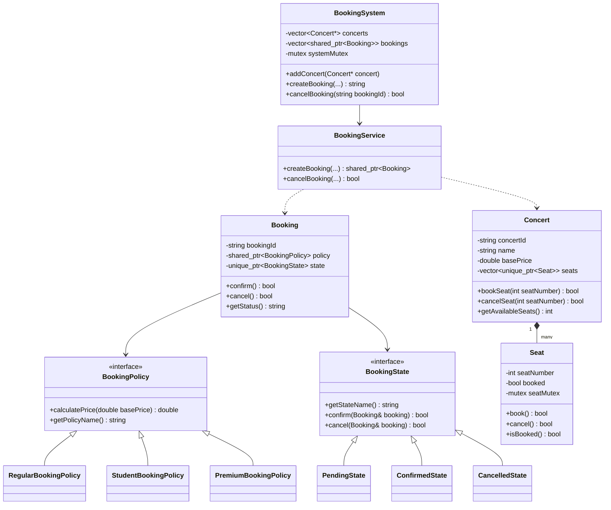

# Concert Ticket Booking System

A console-based concert ticket booking system implemented in C++17. It manages concerts and seat inventories, applies configurable ticket pricing policies, tracks booking lifecycles, and provides thread-safe seat reservation handling to prevent double bookings.

## Features

- Concert creation and venue management
- Real-time seat inventory and availability tracking
- Ticket booking and cancellation workflows
- Configurable ticket pricing policies (regular, student discount, premium surcharge)
- Booking lifecycle management (pending, confirmed, cancelled)
- Mutex-based thread safety for seat reservations and cancellations
- Prevention of double bookings under concurrent requests

## Tech Stack

- C++ (C++17 standard)
- Standard Template Library (STL containers, smart pointers)
- Object-Oriented Programming (OOP)
- Multithreading and synchronization (`std::thread`, `std::mutex`, `std::lock_guard`, `std::scoped_lock`)

## Project Structure

```text
concertBookingSystem/
├── Booking.hpp / Booking.cpp             # Booking entity with state and policy references
├── BookingPolicy.hpp / BookingPolicy.cpp # Strategy pattern interface and pricing policies
├── BookingService.hpp / BookingService.cpp # Booking and cancellation workflow service
├── BookingState.hpp / BookingState.cpp   # State pattern interface and lifecycle states
├── BookingSystem.hpp / BookingSystem.cpp # System coordinator and facade
├── Concert.hpp / Concert.cpp             # Concert details and seat inventory
├── ConcertBookingDemo.cpp                # Demo application
├── Seat.hpp / Seat.cpp                   # Seat entity with per-seat mutex protection
├── run.bat                               # Windows build and run batch script
├── README.md                             # Documentation
└── tests/
    └── ConcertBookingTests.cpp           # Automated unit and concurrency test suite
```

### Key Files

- `Seat`: Represents an individual seat, holding seat number, booked status, and a dedicated mutex.
- `Concert`: Stores concert metadata (ID, artist/event name, venue, date, base price) and manages a vector of seats.
- `Booking`: Represents a user booking record, holding ticket price, customer information, assigned seat, current state, and applied policy.
- `BookingService`: Orchestrates the step-by-step booking and cancellation workflows.
- `BookingSystem`: Manages collections of concerts and bookings, providing public methods for client interactions.

## Architecture Overview



## Design Patterns

### Strategy Pattern (Pricing Policies)
The `BookingPolicy` interface defines price calculation logic via `calculatePrice(double basePrice)`. Concrete implementations include `RegularBookingPolicy` (standard price), `StudentBookingPolicy` (applies a percentage discount), and `PremiumBookingPolicy` (applies a surcharge). This allows pricing rules to vary dynamically without altering booking logic.

### State Pattern (Booking Lifecycle)
The `BookingState` interface encapsulates valid state transitions through `confirm()` and `cancel()`. Concrete states are `PendingState`, `ConfirmedState`, and `CancelledState`. Invalid transitions, such as attempting to cancel an already cancelled booking or confirming a cancelled booking, are rejected by the state objects directly.

## How It Works

### Booking Workflow
1. **Select Concert and Seat**: Client requests a reservation specifying the concert, seat number, customer name, and optional pricing policy.
2. **Atomic Seat Reservation**: `BookingService` calls `Concert::bookSeat()`, which delegates to `Seat::book()`.
3. **Availability Validation**: `Seat::book()` acquires its mutex, checks availability, and updates the status atomically. If already booked, the request fails immediately.
4. **Price Calculation**: The chosen `BookingPolicy` calculates the final ticket price from the concert base price.
5. **Confirmation**: A `Booking` instance is created in `PendingState` and transitioned to `ConfirmedState`. If confirmation fails, the seat reservation is rolled back.

### Cancellation Workflow
1. Client calls `BookingSystem::cancelBooking()` with the booking ID.
2. `Booking::cancel()` is invoked under mutex protection, delegating to the current state.
3. If in `ConfirmedState`, the booking transitions to `CancelledState`, and the assigned seat in `Concert` is released.
4. If already in `CancelledState`, the operation returns `false` without modifying seat availability.

## Concurrency and Thread Safety

Concurrent reservations can lead to double booking if availability checks and seat status updates are not synchronized. To address this:

- **Seat-Level Synchronization**: Each `Seat` instance contains an internal `std::mutex`. In `Seat::book()`, checking whether the seat is free and setting `booked = true` occur inside a single critical section protected by `std::lock_guard<std::mutex>`. If multiple threads attempt to reserve the same seat concurrently, exactly one succeeds and all others are rejected.
- **System-Level Synchronization**: `BookingSystem` uses `systemMutex` to synchronize booking ID generation and modifications to the shared bookings collection.
- **Booking State Synchronization**: `Booking` protects state transitions (`confirm()` and `cancel()`) with `bookingMutex` to prevent data races.

## Build and Run

### Prerequisites
A C++ compiler with C++17 support (GCC 7+, Clang 6+, or MSVC 2017+).

### Windows

Using the batch script:
```cmd
run.bat
```

Or manual compilation using `g++`:
```cmd
g++ -static -std=c++17 -I. -o ConcertBookingDemo.exe Seat.cpp Concert.cpp BookingPolicy.cpp BookingState.cpp Booking.cpp BookingService.cpp BookingSystem.cpp ConcertBookingDemo.cpp
ConcertBookingDemo.exe
```

### Linux / macOS

```bash
g++ -std=c++17 -pthread -I. -o ConcertBookingDemo Seat.cpp Concert.cpp BookingPolicy.cpp BookingState.cpp Booking.cpp BookingService.cpp BookingSystem.cpp ConcertBookingDemo.cpp
./ConcertBookingDemo
```

## Running Tests

An automated test suite is provided in `tests/ConcertBookingTests.cpp`. It covers:
- Concert creation and seat count verification
- Valid seat booking and availability updates
- Rejecting duplicate bookings on the same seat
- Out-of-bounds seat requests (e.g., negative or exceeding capacity)
- Successful booking cancellation and seat restoration
- Rejecting repeated cancellations on already cancelled bookings
- Pricing calculations for regular, student, and premium policies
- Valid and invalid booking state transitions
- Multithreaded concurrent booking of the same seat (verifying exactly 1 succeeds)
- Multithreaded concurrent booking of distinct seats (verifying all succeed)

### Compiling and Running Tests

**Windows:**
```cmd
g++ -static -std=c++17 -I. -o tests\ConcertBookingTests.exe Seat.cpp Concert.cpp BookingPolicy.cpp BookingState.cpp Booking.cpp BookingService.cpp BookingSystem.cpp tests\ConcertBookingTests.cpp
.\tests\ConcertBookingTests.exe
```

**Linux / macOS:**
```bash
g++ -std=c++17 -pthread -I. -o tests/ConcertBookingTests Seat.cpp Concert.cpp BookingPolicy.cpp BookingState.cpp Booking.cpp BookingService.cpp BookingSystem.cpp tests/ConcertBookingTests.cpp
./tests/ConcertBookingTests
```

The test runner executes 13 test suites and checks 58 assertions.
