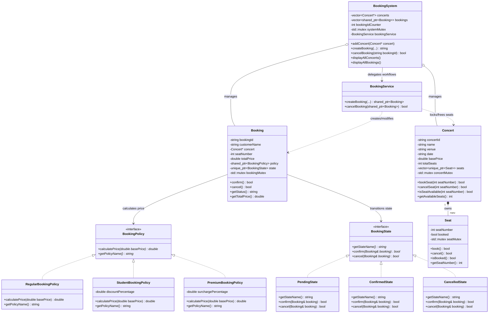
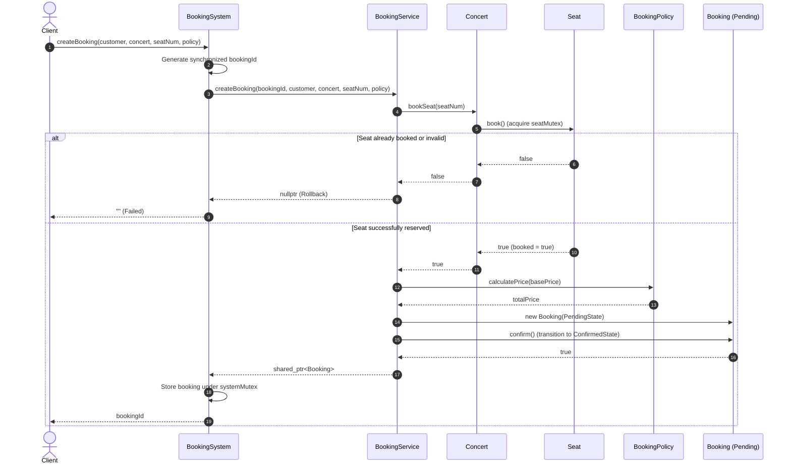
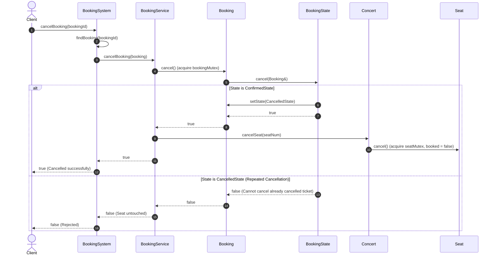

# Concert Ticket Booking System (C++, LLD & Concurrency)

A modular, production-grade **Low-Level Design (LLD)** implementation of a Concert Ticket Booking System in modern C++ (C++17). The system demonstrates object-oriented design, SOLID principles, design patterns (**Strategy** and **State**), and thread-safe **mutex-based synchronization** for high-contention concurrent seat reservations.

---

## 1. Resume Claims Alignment

| Resume Claim | Implementation Highlights | Key Classes / Code |
| :--- | :--- | :--- |
| **1. Modular architecture using C++, OOP & SOLID** | Decoupled entities, interfaces, and modular service layers conforming to SRP, OCP, LSP, ISP, and DIP. | `Seat`, `Concert`, `Booking`, `BookingService`, `BookingSystem` |
| **2. Modular booking and cancellation workflows** | Standalone business logic service orchestrating atomic locking, price calculation, validation, state transitions, and rollbacks. | `BookingService::createBooking()`, `BookingService::cancelBooking()` |
| **3. Strategy & State Design Patterns** | Strategy pattern for extensible pricing policies; State pattern for ticket lifecycle management without monolithic conditionals. | `BookingPolicy`, `RegularBookingPolicy`, `StudentBookingPolicy`, `PremiumBookingPolicy`<br>`BookingState`, `PendingState`, `ConfirmedState`, `CancelledState` |
| **4. Mutex-based synchronization** | Granular seat-level and system-level `std::mutex` locking to prevent race conditions and guarantee zero double-booking under concurrency. | `Seat::book()`, `Seat::cancel()`, `Concert::bookSeat()`, `BookingSystem::systemMutex` |

---

## 2. System Architecture



---

## 3. Class Responsibilities

1. **`Seat`**: Represents a single physical seat. Holds an internal `std::mutex` to ensure that testing availability and setting reservation status is atomic.
2. **`Concert`**: Represents a concert event (ID, name, venue, date, base price). Owns a collection of seats via `std::vector<std::unique_ptr<Seat>>` and validates seat index boundaries.
3. **`Booking`**: Encapsulates an individual customer booking. Manages its own lifecycle through a `BookingState` pointer, pricing through a `BookingPolicy` pointer, and synchronizes state mutations via a dedicated mutex.
4. **`BookingPolicy`** *(Strategy Interface)*: Defines the ticket pricing strategy (`calculatePrice()`), implemented by `RegularBookingPolicy`, `StudentBookingPolicy`, and `PremiumBookingPolicy`.
5. **`BookingState`** *(State Interface)*: Defines the lifecycle contract (`confirm()`, `cancel()`), implemented by `PendingState`, `ConfirmedState`, and `CancelledState`.
6. **`BookingService`**: Core modular service that coordinates the business logic for seat reservation, pricing calculation, state transitions, and rollbacks.
7. **`BookingSystem`**: Central facade and manager that coordinates concert and booking registries with thread safety.

---

## 4. Key Workflows

### 4.1 Booking Workflow (`BookingService::createBooking`)


### 4.2 Cancellation Workflow (`BookingService::cancelBooking`)


---

## 5. Design Patterns Explained

### 5.1 Strategy Design Pattern (Flexible Pricing)
- **Problem**: Hardcoding price calculations or discounts using `switch` or `if-else` violates the Open/Closed Principle. Adding a new discount policy requires modifying existing core booking logic.
- **Solution**: The `BookingPolicy` abstract class defines a uniform price calculation interface.
- **Implementations**:
  - `RegularBookingPolicy`: Returns 100% of base price.
  - `StudentBookingPolicy`: Applies configurable discount (e.g., 20% off base price).
  - `PremiumBookingPolicy`: Applies configurable surcharge (e.g., 25% VIP fee).
- **Extensibility**: To add a new pricing strategy (e.g. `EarlyBirdBookingPolicy` or `GroupDiscountPolicy`), create a new subclass of `BookingPolicy`. Zero modifications to `BookingService` or `BookingSystem` are required.

### 5.2 State Design Pattern (Ticket Lifecycle Management)
- **Problem**: Tracking booking states (`PENDING`, `CONFIRMED`, `CANCELLED`) with enum flags and conditional statements leads to fragile code, invalid transitions, and duplicate cancellation vulnerabilities.
- **Solution**: The `BookingState` abstract interface delegates transition logic directly to polymorphic state classes:
  - `PendingState`: Allows `confirm()` (moves to `ConfirmedState`) or `cancel()` (moves to `CancelledState`).
  - `ConfirmedState`: Active reserved ticket. Allows `cancel()` (moves to `CancelledState`). Rejects duplicate `confirm()`.
  - `CancelledState`: Terminal state. Rejects further `confirm()` or repeated `cancel()`.
- **Validation**: Attempting to cancel an already cancelled booking returns `false`, preserving data integrity and preventing invalid seat deallocations.

---

## 6. Mutex-Based Concurrency & Thread Safety

### 6.1 Critical Sections & Synchronization
- **Granular Seat Locking**: Each `Seat` object encapsulates its own `mutable std::mutex seatMutex`. When `Seat::book()` is invoked:
  ```cpp
  bool Seat::book() {
      std::lock_guard<std::mutex> lock(seatMutex);
      if (booked) {
          return false;
      }
      booked = true;
      return true;
  }
  ```
  Both checking availability and setting the `booked` flag are performed atomically inside the lock.
- **Concert Registry Protection**: `Concert::getAvailableSeats()` locks `concertMutex` to ensure accurate seat counts across concurrent threads.
- **Global Booking Registry**: `BookingSystem` utilizes `systemMutex` to synchronize booking ID generation and additions/queries to the `bookings` container.
- **Booking State Synchronization**: `Booking` uses `bookingMutex` to prevent concurrent race conditions between confirmation and cancellation.

### 6.2 Deadlock Prevention
- Lock acquisition order is strictly unidirectional: `systemMutex` -> `concertMutex` -> `seatMutex` -> `bookingMutex`. Locks are never held across unrelated recursive calls.

---

## 7. SOLID Principles Applied

1. **Single Responsibility Principle (SRP)**:
   - `Seat`: Responsible only for seat state and atomic locking.
   - `Concert`: Responsible only for venue and seat inventory management.
   - `BookingService`: Dedicated to orchestrating booking/cancellation workflows.
   - `BookingPolicy`: Dedicated solely to pricing algorithms.
   - `BookingState`: Dedicated solely to state validation and transitions.
2. **Open/Closed Principle (OCP)**:
   - New pricing strategies and new lifecycle states can be added by implementing interfaces without modifying existing code.
3. **Liskov Substitution Principle (LSP)**:
   - Any `BookingPolicy` (`Regular`, `Student`, `Premium`) can be passed interchangeably to `createBooking()` without breaking behavior.
   - Any `BookingState` fulfills the state transition contract.
4. **Interface Segregation Principle (ISP)**:
   - Interfaces (`BookingPolicy`, `BookingState`) are focused and concise without forcing implementations to depend on unused methods.
5. **Dependency Inversion Principle (DIP)**:
   - High-level modules (`BookingService`, `Booking`) depend on abstractions (`BookingPolicy`, `BookingState`), not on concrete implementations.

---

## 8. Compilation & Execution

### Prerequisites
- Modern C++ compiler supporting **C++17** or later (e.g. MinGW-w64 GCC 7+, Clang 6+, or MSVC 2017+).

### Quick Run (Windows)
Double-click `run.bat` or execute in terminal:
```cmd
run.bat
```
This script automatically compiles the project, runs the test suite, and starts the live demo.

### Manual Compilation

**Compile Demo:**
```cmd
g++ -static -std=c++17 -I. -o ConcertBookingDemo.exe Seat.cpp Concert.cpp BookingPolicy.cpp BookingState.cpp Booking.cpp BookingService.cpp BookingSystem.cpp ConcertBookingDemo.cpp
```

**Run Demo:**
```cmd
.\ConcertBookingDemo.exe
```

**Compile & Run Automated Tests:**
```cmd
g++ -static -std=c++17 -I. -o tests\ConcertBookingTests.exe Seat.cpp Concert.cpp BookingPolicy.cpp BookingState.cpp Booking.cpp BookingService.cpp BookingSystem.cpp tests\ConcertBookingTests.cpp
.\tests\ConcertBookingTests.exe
```

---

## 9. Test Suite Verification

The automated test suite (`tests/ConcertBookingTests.cpp`) validates all 13 core requirements:

| # | Test Case | Target Invariant | Result |
| :---: | :--- | :--- | :---: |
| 1 | `testConcertCreation` | Initial availability matches total seat capacity | **PASSED** |
| 2 | `testValidSeatBooking` | Seat booked, status is `CONFIRMED`, price computed | **PASSED** |
| 3 | `testBookAlreadyBookedSeat` | Re-booking same seat returns failure | **PASSED** |
| 4 | `testInvalidSeatSelection` | Out-of-bounds seats (0, negative, > total) rejected | **PASSED** |
| 5 | `testSuccessfulCancellation` | Booking status set to `CANCELLED`, seat freed | **PASSED** |
| 6 | `testRepeatedCancellation` | Second cancellation on same booking is rejected | **PASSED** |
| 7 | `testRegularPricing` | Base price preserved ($100 -> $100) | **PASSED** |
| 8 | `testStudentPricing` | 20% and custom discount applied ($100 -> $80) | **PASSED** |
| 9 | `testPremiumPricing` | 20% and 50% VIP surcharge applied ($100 -> $120) | **PASSED** |
| 10 | `testValidStateTransitions` | `PENDING` -> `CONFIRMED` -> `CANCELLED` verified | **PASSED** |
| 11 | `testInvalidStateTransitions` | `CONFIRMED` -> `CONFIRMED` & `CANCELLED` -> `CONFIRMED` rejected | **PASSED** |
| 12 | `testConcurrentSameSeatBooking` | **20 threads compete for 1 seat: exactly 1 wins, 19 fail** | **PASSED** |
| 13 | `testConcurrentDifferentSeatsBooking`| **30 threads book 30 distinct seats: 30 succeed, 0 fail** | **PASSED** |

**Total Invariants Verified: 58/58 Passed (0 Failures).**
